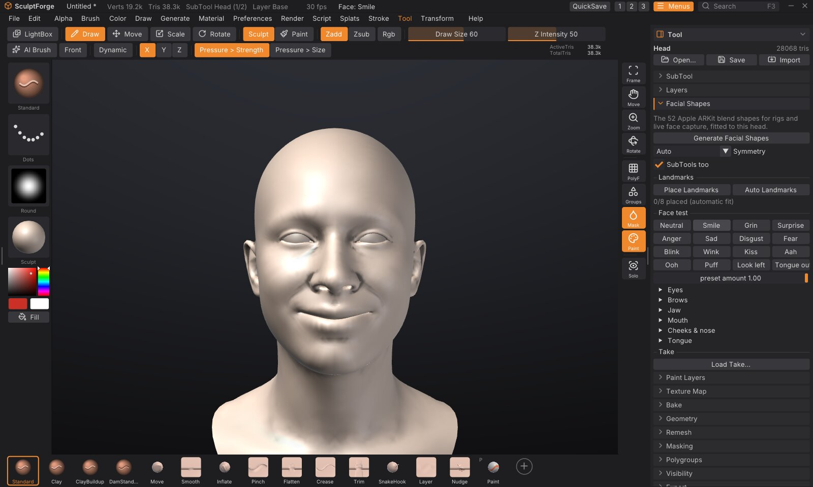
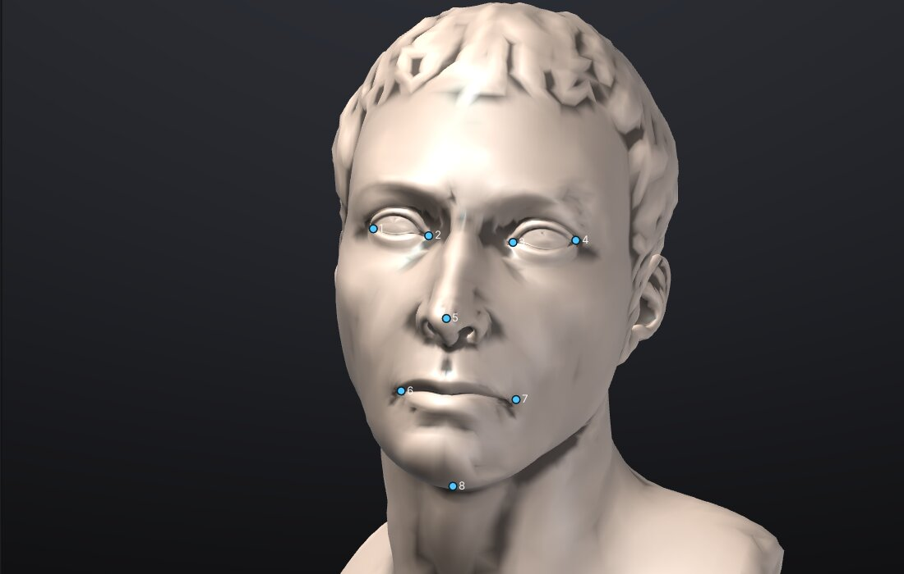
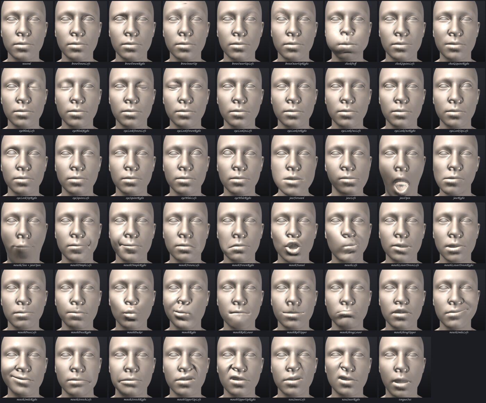
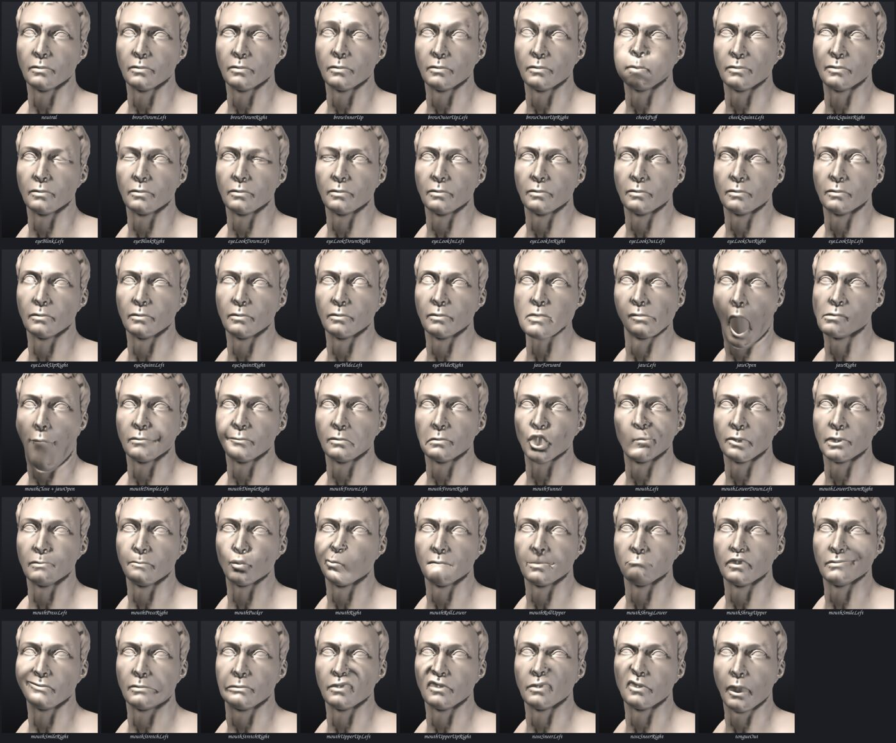

# Facial shapes and live face

**Generate Facial Shapes** gives a sculpted head the 52 blend shapes Apple ARKit and Google's MediaPipe use for
face capture (`eyeBlinkLeft`, `jawOpen`, `mouthSmileRight` and the rest), fitted to that head's own proportions.
They are ordinary [sculpt layers](layers.md): you fix any of them by sculpting, test them with expression presets,
export them as morph targets to a rig, a game engine or Blender, and drive them live, so the character makes your
expressions.



## What you need

- A humanoid head (human or stylised) as the active [SubTool](subtools.md), its face pointing at the front view
  (+Z) with Y up, as SculptForge's front view shows it. A bust with shoulders is fine.
- Separate SubTools for the eyes, teeth and tongue, if the sculpt has them (see [SubTools](#subtools)).
- Nothing to download: the template head the shapes come from is built into SculptForge.

To try it on a ready-made head, type `new_head` in the console (<kbd>`</kbd>): a life-size human head with a mouth
and eye sockets, and its eyes as a second SubTool.

## Generate the shapes

1. Select the head SubTool and open **Tool > Facial Shapes**.
2. Click **Generate Facial Shapes**. It takes a second or two (more on millions of vertices).
3. The status line says how well the template fitted: the fit error (as a share of the head's height; under 1% is
   good) and how much of the template's face found the sculpt.
4. **Tool > Layers** now lists the 52 shapes, all at weight 0, so the sculpt looks unchanged.

Generating again replaces the 52 layers (other layers stay). Undo brings back the previous ones, together with any
fixes you had sculpted into them.

### Options

- **Symmetry**: **Auto** makes each Left / Right pair exact mirror images when the sculpt is symmetric about X = 0;
  **On** always mirrors (a slightly asymmetric sculpt gets the average); **Off** keeps each side as fitted.
- **SubTools too**: also give the other SubTools the shapes they need (below).

## How it works

SculptForge carries a template head with all 52 shapes: the ICT Face Model Light from
[ICT-FaceKit](https://github.com/ICT-VGL/ICT-FaceKit) by the USC Institute for Creative Technologies, under the MIT
licence (free for commercial work: studios can ship what it makes). Generating:

1. **Finds the face.** Without landmarks it looks for the nose tip (the most forward point near the middle) and
   the head's height, then lines the template's face up with the sculpt's (rotation, scale and position).
2. **Wraps the template around the sculpt** (non-rigid registration): the template is pulled onto the closest
   points of the sculpt, stiffly at first and then more and more loosely, so it takes the sculpt's shape without
   tearing.
3. **Transfers each shape** with deformation transfer: each small piece of the template's surface moves in the
   shape the way it moves on the template, rebuilt on the fitted template. A wide face gets a wide smile, a long jaw
   a long jaw drop.
4. **Binds the sculpt** to the fitted template: every vertex near the face follows the closest point of the
   template, so your sculpted detail (wrinkles, pores) rides along. Vertices away from the face (the back of a
   bust, the shoulders) don't move.

Left and Right are the character's own: `eyeBlinkLeft` closes the character's left eye, which is on your right
in the front view. That is what ARKit and MediaPipe mean.

## Landmarks

If the fit goes wrong (a strongly stylised face, a head turned a lot, a bust whose shoulders stick out further than
the nose), guide it with landmarks:



1. Click **Auto Landmarks** to see where the automatic fit puts the eye corners, the nose tip, the mouth corners and
   the chin.
2. Click **Place Landmarks**. The canvas asks for each landmark in turn (right eye outer corner, right eye inner
   corner, left eye inner, left eye outer, nose tip, right mouth corner, left mouth corner, chin): click it on the
   sculpt. To move one, click its dot, then its new place.
3. Click **Generate Facial Shapes**. With 3 or more landmarks the fit starts from them and pulls the template's
   landmarks onto yours; all 8 fit best.

**Clear** removes them (the fit is automatic again). Landmarks aren't saved with the project.

## SubTools

With **SubTools too** on, the other visible SubTools get shapes by their names:

| SubTool name contains | It gets |
|---|---|
| `eye` (not `lash`, `brow` or `lid`) | the 8 `eyeLook...` shapes: each eye turns about its own centre (about 30 degrees sideways, 25 up or down). One SubTool may hold both eyes. |
| `teeth`, `tooth`, `gum` or `jaw` | the jaw shapes (`jawOpen`, `jawLeft`, `jawRight`, `jawForward`, `tongueOut`): the part below the bite moves with the lower jaw, the upper teeth stay. |
| `tongue` | the jaw shapes, and `tongueOut` pushes it out past the lips. |
| anything else that sits on the face (brows, lashes, a beard, a moustache) | the shapes that move the skin under it. SubTools that aren't on the face get none. |

The eyes' shapes are rotations stored as blend shapes, so halfway (weight 0.5) an eye is a little smaller than a
true rotation would leave it, as with any blend-shape eye. Rigs that turn eyes with bones can ignore those shapes.

## Mouth and eyes: what to expect

- **An open or slit mouth** (the lips separate surfaces, ideally with a mouth bag behind them) opens cleanly:
  `jawOpen` drops the lower lip and the chin, `mouthFunnel` and `mouthPucker` shape the lips.
- **A closed mouth** sculpted as one continuous surface can't open: the shapes that part the lips move the lower lip
  and stretch the skin between the lips like a membrane. Cut the mouth first (sculpt a slit, or start from
  `new_head`, which has a mouth bag), or sculpt the fix into `jawOpen`.
- **Eyelids** close over the eyeballs in `eyeBlinkLeft` / `eyeBlinkRight` when the eyes are a separate SubTool.
  Eyes sculpted into the head's own surface (one mesh) would be pulled along by the lids: split them into their
  own SubTool first ([Split parts](subtools.md)).
- `mouthClose` is meant to be used with `jawOpen`: it closes the lips while the jaw is open (the ARKit convention).
  On its own it pushes the lips through each other.
- `tongueOut`: the template has no tongue shape, so on the head it opens the jaw a little; a tongue SubTool moves out.

## Fix a shape by sculpting

The shapes are a starting point, like a rigger's first pass. To fix one:

1. In **Tool > Layers**, select its layer (the radio button with its name).
2. Set its weight to 1 (its slider here or in Tool > Layers) and the other shapes to 0 (**Neutral** below).
3. Sculpt: every stroke goes into that shape. Use <kbd>X</kbd> symmetry for a centre shape; for a Left / Right
   pair, fix one and regenerate with Symmetry on only if you haven't fixed the other side yet.

## Face test

Under **Face test**:

- **Presets** show common expressions built from the shapes: Neutral, Smile, Grin, Surprise, Anger, Sad,
  Disgust, Fear, Blink, Wink, Kiss, Aah, Ooh, Puff, Look left, Tongue out. **Preset amount** sets how strongly.
- **Eyes, Brows, Jaw, Mouth, Cheeks & nose, Tongue** open a slider per shape. A slider drives the shape of that
  name on every SubTool (the eyes turn with `eyeLookUpLeft`).

Neither creates undo steps. The weights are saved with the project and written to exports (as the default pose).

## All 52 shapes

Each shape at weight 1 on the template head (`new_head`) and on a real sculpture, "Marble Bust 01" by Rico Cilliers
(Poly Haven, CC0), straight out of Generate Facial Shapes, without any fixes:





## Live face

`face_weights` sets shape weights from a JSON object, fast enough for a live feed (30 or more calls a second):

```
face_weights json={"jawOpen":0.4,"eyeBlinkLeft":1,"mouthSmileRight":0.6}
```

It changes only the vertices those shapes move, re-uploads only those to the graphics card, makes no undo step and
doesn't mark the project as changed. Names not given keep their weight; unknown names are reported. The whole face
message from a phone, `{"type":"face","t":...,"weights":{...},"head":[...]}`, works as the JSON too. On a 700,000
vertex head whose every vertex is face, a frame that changes all 52 weights takes about 9 ms on an M1 Pro (most of
it updating normals); heads with a body or shoulders change only the face.

The phone link points your phone's camera at your face and sends this feed, so the character makes your expressions
(see the phone link's own chapter). Anything else that produces ARKit or MediaPipe blendshape weights can drive it
too: a script ([Scripting and automation](scripting.md)), the MCP server or the Python module.

## Takes

A take is a recorded face feed: the phone link saves one as JSON frames, or write your own.

- **Load Take...** plays a take on the shapes, looping (**Loop**), with **Play / Pause**. Accepted: a JSON array of
  face messages, an object with a `"frames"` array, or JSON Lines (one message per line); `"t"` is in milliseconds.
  MediaPipe's `"blendshapes": [{"categoryName": ..., "score": ...}]` works too.
- **Bake Take** turns the loaded take into keyframes at 30 frames a second, kept in the project. Exports then carry
  the animation: **GLB** as a glTF animation of the morph target weights (Blender, three.js, Unity, Godot and Unreal
  play it), **USD** as time samples of the blend shape weights (Omniverse, Maya, Houdini, Blender). FBX exports the
  shapes but not the animation yet.
- **Clear Baked Take** removes it.

From the console: `face_take_play path=take.json`, `face_take_stop`, `face_take_bake path=take.json fps=30`,
`face_take_clear`.

## Export the shapes

The ARKit names are kept exactly in every format:

| Export | The shapes become | Animation (baked take) |
|---|---|---|
| **GLB** (File > Export) | morph targets, named in `extras.targetNames` | glTF animation of the weights |
| **USD / USDZ** | UsdSkel blend shapes | time samples on the SkelAnimation |
| **FBX** (and Send to Unreal) | blend shape channels; Unreal: morph targets on a skeletal mesh | not yet |
| **Blender bridge** (File > Blender > Send to Blender) | shape keys, at their weights, on every object | not yet |

Each SubTool exports as its own object with its own shapes (the eyes with their eyeLook shapes, the teeth with
the jaw's). Apple's ARKit, Unreal's Live Link Face and most face-capture tools drive meshes by these names directly.

## Commands

| Command | What it does |
|---|---|
| `face_shapes_generate [landmarks=<json>] [symmetry=auto/on/off] [subtools=true] [level=N]` | Generate Facial Shapes on the active SubTool |
| `face_landmarks_detect` | the automatic landmarks, as the JSON `landmarks=` takes |
| `face_weights json=<json>` | set shape weights (live) |
| `face_preset name=Smile [amount=1]` | show a preset |
| `face_take_play path=` / `face_take_stop` | play a take in the viewport (the app only) |
| `face_take_bake path= [fps=30]` / `face_take_clear` | bake a take for export / remove it |
| `new_head` | a new scene with the template head and its eyes |

## Subdivision levels

On a SubTool with [subdivision levels](subdivision-levels.md) the shapes are made on the lowest level with at least
20,000 vertices (`level=` picks another), and the levels carry them up: at the top level the shapes bend your
high-level detail along instead of flattening it.

## Memory

Each shape is a full sculpt layer: 52 shapes add about 620 bytes per vertex (on top of what the mesh itself uses),
so about 620 MB on a million-vertex head. Generate on a level of a million vertices or less and let the levels carry
the shapes up.

## Limits

- The fit expects a humanoid head with the face pointing at the front view. Animals and creatures (the lion bust)
  fit poorly or not at all; landmarks help with stylised humans.
- Hair sculpted as part of the head moves with the brows and forehead; keep hair in its own SubTool.
- Landmarks are placed by hand or found by the fit itself; there is no image-based face detector.
