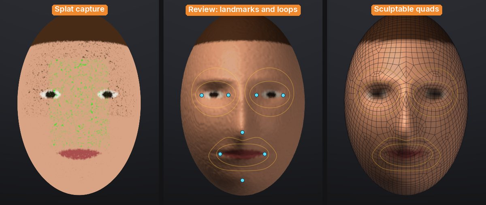
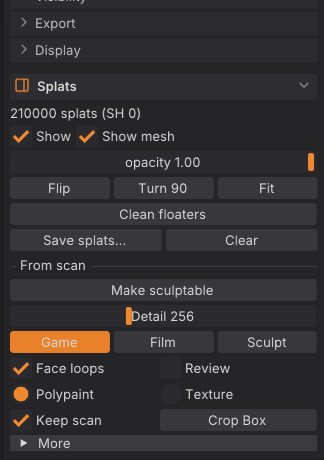

# From scan to sculptable mesh

A Gaussian-splat capture looks great but you can't sculpt, rig or animate it. **Make sculptable** turns it into
a clean SubTool you can: a watertight surface with the floaters and background gone, quad topology at the
polygon budget you choose, edge loops round the eyes and mouth when the capture is a head, and the capture's
colours as polypaint or a texture. One click, in the background, with the splats kept next to the result.



## One click

1. Load a capture (see [Gaussian splats](splats.md)): **File > Open...** or drop a `.ply`, `.splat`, `.glb` or
   `.usdz` onto the window. Place it with **Flip**, **Turn 90** and **Fit** if it arrives upside down.
2. For a head, turn the view so you look at the face, roughly from the front (within about 40 degrees is
   enough). The face is looked for from the current view.
3. In the **Splats** palette, under **From scan**, click **Make sculptable**.

A progress bar and **Cancel** show while it works. When it's done:

- a new SubTool named after the capture holds the sculptable mesh, and is active;
- a hidden **"<name> Scan"** SubTool keeps the dense voxel surface it was made from (turn off **Keep scan** if you
  don't want it);
- the splats are hidden, not deleted (**Show** in the Splats palette brings them back);
- an untouched starting sphere is hidden too.

No capture at hand? **Try a test head** in the Splats palette (shown while no splats are loaded) loads a built-in
one: a stylised head as 200,000 coloured splats with a few floaters and the hidden inside splats real captures
have. `splat_test_capture kind=object` loads a mug with a thin handle instead.



## The options

| Control | What it does |
|---|---|
| **Detail** | How finely the surface follows the capture, in voxels across the subject (96 to 512, default 256). Higher keeps thinner parts and more detail and takes longer |
| **Game / Film / Sculpt** | The polygon budget. **Game**: about 4,000 quads, for real-time characters and props. **Film**: about 12,000 quads, for close-ups and smooth deformation. **Sculpt**: a 2,000-quad base with two subdivision levels, the scan's detail projected onto the top level, so you sculpt with levels straight away |
| **Face loops** | When the capture is a head: find the eyes, nose, mouth and chin and give QRemesh edge loops round the eyes and mouth and along the nasolabial folds, mirrored across the face (see below) |
| **Review** | Stop after the scan to check the face landmarks and the loops before remeshing |
| **Polypaint / Texture** | Where the capture's colours go: the vertices (polypaint), or a 2K texture on automatic UVs (sharp colour on a light mesh, for games and exports) |
| **Keep scan** | Keep the dense voxel surface as a hidden "<name> Scan" SubTool, to ProjectAll more detail from later |
| **Crop Box** | Only the splats inside the box count (see below) |
| **More > Min Opacity** | Splats fainter than this are ignored (haze and floaters are usually faint). Default 0.2 |
| **More > Close Gaps** | Seal gaps up to this many voxels between splats. Default 2 |
| **More > Fill holes** | Fill big holes such as the open bottom of a subject that stood on a table. Turn it off for open cavities like a cup |
| **More > All pieces** | Keep every solid piece instead of only the largest (the floaters come back too) |

Hold <kbd>Ctrl</kbd> and point at any of them for help; <kbd>F3</kbd> finds **Make sculptable**, **Finish**,
**Place by hand** and **Crop Box** by name.

## Face loops: animation topology for heads

Faces deform around the eyes and the mouth, so animation topology has rings of edges there and a loop from the
nose down past the mouth corners (the nasolabial fold), the same on both sides. With **Face loops** on, Make
sculptable looks for a face on the scan as seen from the current view: a depth and colour picture of it, the
middle line where it is mirror-symmetric, the nose as the strongest bump on that line, the eyes as a matching
pair of hollows (and darker spots) above it, the line between the lips below it, then the chin. From those
eight landmarks (the corners of both eyes, the nose tip, the mouth corners, the chin) it draws
[QRemesh Guides](retopology.md#qremesh-guides) for QRemesh to follow:

- a ring round each eye, and a bigger one round the eye socket when the polygon budget is high enough for it;
- a ring round the lips;
- the nasolabial loop: from each side of the nose down the fold past the mouth corner and under the lower lip;
- all of them mirrored across the face, and QRemesh's symmetry on, so both halves get the same edge flow.

The guides stay on the result SubTool, so you can **QRemesh** it again at another density (Geometry > QRemesh)
and the loops come back. Small loops are left out at low budgets, where they couldn't come out as clean rings.

If no face is found (the status bar says why), the result is remeshed without face loops. Turn the view to face
the head and run it again, or use Review and place the landmarks by hand.

### Review and nudge the landmarks

With **Review** on, Make sculptable stops after the scan: the "<name> Scan" SubTool shows with the landmarks as
blue dots and the guide loops as orange lines.

- **Drag a dot** to move a landmark onto the right spot. Its partner on the other side follows (mirrored), and
  the loops are rebuilt when you let go.
- **Place by hand** asks for the eight landmarks one click at a time (the panel and the cursor say which is
  next): the outer and inner corner of the eye on the left of the screen, the inner and outer corner of the
  other eye, the nose tip, the left and right mouth corners, the chin.
- **Find again** looks for the face again from the current view.
- **Finish** remeshes the scan along the loops and colours it; **Back** leaves the review and keeps the scan.

## The crop box

Captures usually include the ground, a table or the room. **Make sculptable** keeps only the largest solid
piece, which drops floaters, but a table the subject stands on is joined to it. Click **Crop Box**: a yellow box
appears round the capture with a handle on each face. Drag a handle to move that face (drag the bottom one up to
cut the table away), then **Make sculptable**: only the splats inside the box count. The box shows while the
splats are shown; click **Crop Box** again to turn it off.

## What happens inside

1. **Surface.** Every Gaussian adds its opacity-weighted density to a voxel grid (in parallel, with the same
   result on any number of threads). Where the density is high enough is the shell of the subject; small gaps
   close, small separate pieces of shell (floaters) are dropped, and space boxed in by the shell on five of six
   sides counts as inside, which seals big holes such as an open bottom. The outside is flooded from the edges,
   the largest solid piece is kept, and a smooth watertight surface is made from it.
2. **Colour.** Each vertex (or texel) takes the colour of the splats around it, weighted by their opacity and
   distance. Splats behind the surface, inside the subject, are faded out: trained captures fill the inside with
   splats of any colour.
3. **Topology.** QRemesh rebuilds the scan as quads at the budget's polygon count, along the face guides, with
   symmetry. **Sculpt** then divides it twice and projects the scan onto the top level (as ProjectAll does).

## Speed

Measured on an M1 Pro laptop (10 cores, 2021) with the built-in test head at **Film** density, from click to the
finished SubTool:

| Splats | Detail 256 | Detail 384 | Detail 512 | Peak memory (512) |
|---|---|---|---|---|
| 1 million | 3.4 s (surface 1.3 s) | 5.5 s (surface 2.6 s) | 8.8 s (surface 5.1 s) | 1.0 GB |
| 5 million | 7.2 s (surface 4.2 s) | 9.1 s (surface 5.6 s) | 13.2 s (surface 8.0 s) | 1.2 GB |

The rest of the time is QRemesh and colour. Everything runs on the CPU, so a studio PC with more cores is
faster; no GPU or CUDA is needed.

## How good is it?

What works well:

- Watertight, manifold surfaces every time (no holes, no non-manifold edges), with floaters and stray background
  pieces dropped and open bottoms sealed.
- Faithful colour: on test captures with known colours the transferred polypaint is within a few percent of the
  original, and the wrongly coloured splats inside the subject don't bleed through.
- Clean quads (97% or more) with symmetric rings round the eyes and mouth on faces it finds.
- Thin parts survive down to a few voxels across (a mug handle at Detail 160 stays a handle, its hole open).

What to expect:

- The scan has a fine ripple (voxel-scale, a little like orange peel) where the capture's splats are sparse;
  the quad result smooths it out, but the **Sculpt** preset projects it onto the top level, where the Smooth
  brush takes it away.
- The surface sits about a voxel outside the splats (the shell's thickness). Raise **Detail** to make that smaller.
- The face finder works from geometry and colour, not a trained model: it is reliable on clear faces seen from
  the front (busts, maquettes, game heads) and can miss on heavily stylised faces, closed-eye or beard-covered
  ones, profiles, or a head that isn't upright in the view. Then use Review and **Place by hand**.
- Fill holes also fills deep open cavities (the inside of a cup, an open mouth); turn it off for those.
- Hair and fur become a solid shell, as with any surface reconstruction.
- Splat captures carry view-dependent colour; Make sculptable uses the base colour of each splat (no
  reflections or highlights baked in), which is what you want for a sculpt.

## From scripts

The same pipeline runs from the console, `sculptforge-cli`, MCP and Python:

| Command | What it does | Key parameters |
|---|---|---|
| `splat_to_mesh` | Make sculptable | `detail` (32 to 768, default 256; `resolution` is the same), `preset` (game, film or sculpt), `target` (quads; 0 keeps the voxel surface), `levels`, `face_guides` (auto or off), `landmarks` (JSON, instead of finding them), `front`, `up` (the face's directions, default `"0 0 1"` and `"0 1 0"`), `color` (polypaint, texture or none), `texture_size`, `crop` (`"minx miny minz maxx maxy maxz"`), `min_opacity`, `keep`, `close`, `fill_holes`, `keep_parts`, `smooth`, `symmetry`, `keep_scan`, `stage` (all, scan or finish), `seed` |
| `face_guides` | Finds a face on the active SubTool (or takes `landmarks`) and replaces its QRemesh Guides with the face loops; the message ends with the landmarks as JSON | `landmarks`, `front`, `up`, `target` |
| `splat_test_capture` | Loads the built-in test head or mug capture | `kind` (head or object), `count`, `floaters`, `open_bottom` |

```sh
# A scan to a textured game asset, in one go.
sculptforge-cli -c 'open path=bust.ply; splat_transform rotate_x=180 fit=true; splat_to_mesh preset=game color=texture; export_glb path=bust.glb'

# The app's review in two steps: the scan with its face guides (the message lists the landmarks found), then the
# quads along those guides.
sculptforge-cli -c 'open path=head.ply; splat_to_mesh stage=scan preset=film; splat_to_mesh stage=finish preset=film; export_glb path=head.glb'
```

To correct the landmarks from a script, run `face_guides` between the two stages with `landmarks=` set to the
JSON the scan stage printed, edited: `{"eye_outer_l": [x, y, z], "eye_inner_l": [...], "eye_inner_r": [...],
"eye_outer_r": [...], "nose_tip": [...], "mouth_l": [...], "mouth_r": [...], "chin": [...]}` (`l` is the side on
the left of the screen when looking at the face).

Each run in the app is echoed to the console as a `splat_to_mesh` line (with the landmarks when you reviewed
them), so you can copy it into a batch script.

## See also

- [Gaussian splats](splats.md): loading, placing and saving captures
- [Quad retopology and detail projection](retopology.md): QRemesh, QRemesh Guides and ProjectAll
- [Subdivision levels](subdivision-levels.md): sculpting the **Sculpt** preset's levels
- [Texture painting](texture-painting.md): painting on the **Texture** result
